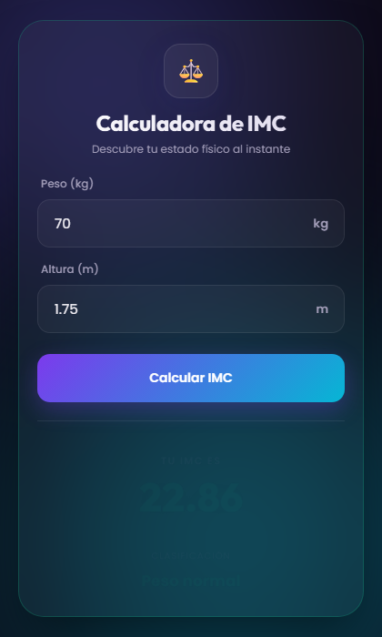

# CalculadoraIMC

Aplicación de escritorio para calcular el índice de masa corporal (IMC), hecha
con Electron. Funciona sin conexión y no envía ni guarda datos.



## Qué hace

- Calcula el IMC a partir del peso en kilogramos y la altura en metros.
- Acepta coma o punto como separador decimal.
- Clasifica el resultado según la OMS: bajo peso, peso normal, sobrepeso y
  obesidad.
- Valida campos vacíos, valores no numéricos y alturas fuera de rango.
- Permite calcular con Enter.
- Todo se ejecuta en la ventana: no hay servidor ni base de datos.

## Requisitos

- Node.js 18 o superior (probado con 24.18.1).
- Windows para generar el ejecutable con el script incluido.
- Las fuentes se cargan desde Google Fonts; sin internet se usan las del
  sistema.

## Ejecutar

```bash
npm install
npm start
```

## Generar el ejecutable

En Windows, doble clic en `build_desktop.bat` o:

```bash
npm install
npm run package
```

El resultado queda en `dist/CalculadoraIMC-win32-x64/CalculadoraIMC.exe`. El
ejecutable no se versiona porque pesa alrededor de 172 MB y supera el límite de
GitHub.

## Estructura

```
main.js              proceso principal de Electron
web/index.html       interfaz
web/style.css        estilos
web/script.js        cálculo y validaciones
build_desktop.bat    instalación y empaquetado en Windows
```

## Notas

- El IMC es una referencia poblacional, no un diagnóstico médico.
- El ejecutable generado no está firmado; Windows puede mostrar un aviso de
  SmartScreen.

## Licencia

MIT. Ver `LICENSE`.
